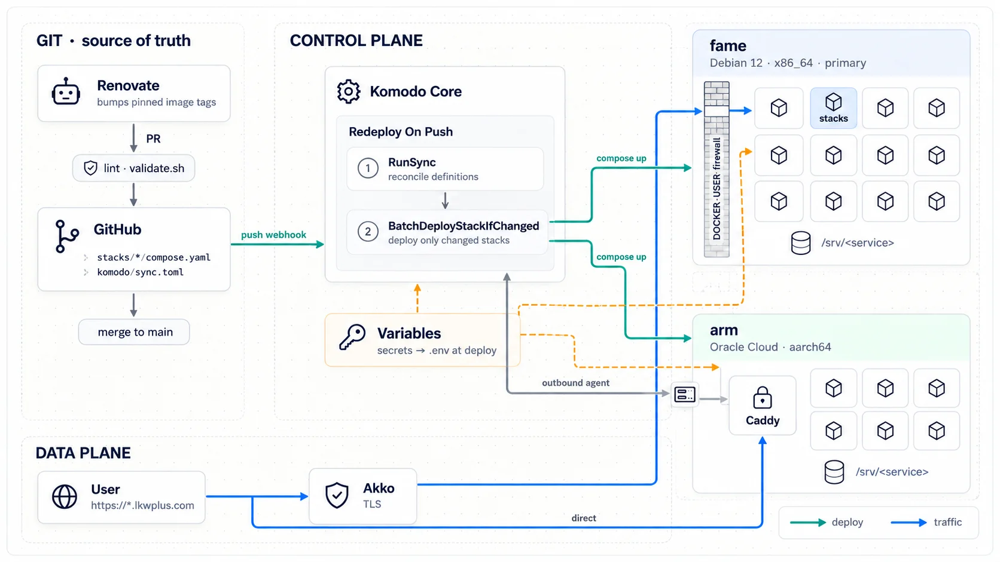

# homelab-infra

[](https://github.com/synthpop123/homelab-infra/actions/workflows/lint.yml)

GitOps for self-hosted services managed by [Komodo](https://komo.do). Each service is a Docker
Compose **Stack** with **pinned** image versions, updated automatically via
[Renovate](https://docs.renovatebot.com) pull requests.



## How it works

**Merging is deploying.** A push to `main` fires one webhook into the `Redeploy On Push`
procedure on Komodo Core, which runs two strictly ordered steps: ① `RunSync` reconciles stack
*definitions* from [`komodo/sync.toml`](./komodo/sync.toml), then ② `BatchDeployStackIfChanged`
`docker compose up`s only the stacks whose compose files changed — on **fame** directly, or on
**arm** through its outbound Periphery agent. Secrets come from Komodo **Variables**, written
into each stack's `.env` at deploy time. There is no CI in the deploy path — the only gate is a
lint workflow on relevant infrastructure PRs (`yamllint` + `docker compose config` + bootstrap
shell syntax + cross-file consistency, runnable locally as `./scripts/validate.sh`). Renovate watches every pinned
`image:` tag and opens bump PRs, so routine updates are review-and-merge.
Details: [workflow.md](./docs/workflow.md).

On the request path, fame's services sit behind the **Akko** reverse proxy (the host firewall
admits only Akko), while arm's are reached directly through arm's own host **Caddy** — see
[Networking & security](#networking--security).

## Layout

```
.
├── stacks/<service>/compose.yaml   # one folder per service: pinned image, /srv binds, host port
├── komodo/sync.toml                # Komodo Resource Sync + redeploy Procedure (IaC)
├── bootstrap/komodo/               # Komodo itself (Core/Periphery/Mongo): deployed by hand
├── bootstrap/firewall/             # host firewall (DOCKER-USER rules): deployed by hand
├── bootstrap/fail2ban/             # sshd brute-force jail: deployed by hand
├── bootstrap/media/                # STRM housekeeping timers on fame: deployed by hand
├── renovate.json                   # Renovate config (auto-detects stacks/*/compose.yaml)
├── scripts/validate.sh             # pre-deploy lint (stacks/bootstrap/Komodo/Renovate/consistency)
├── .github/workflows/lint.yml      # runs validate.sh on infra PRs (no VPS access)
├── web/                            # homelab.lkwplus.com: the catalog as a page, on a Cloudflare Worker
└── docs/                           # conventions, host/ops/media docs, runbooks
```

## Services

One row per stack; a stack's containers, images and versions are its
[`compose.yaml`](./stacks/). The live view of this table is
[homelab.lkwplus.com](https://homelab.lkwplus.com) ([`web/`](./web/)).

### fame

Reached as `https://<name>.lkwplus.com` through the Akko reverse proxy; the host ports are
not directly reachable from the internet (see [Networking](#networking--security)).

| Service | URL | Port | Description |
|---------|-----|------|-------------|
| [wallos](./stacks/wallos) | [wallos.lkwplus.com](https://wallos.lkwplus.com) | 20000 | Subscription tracker |
| [calibre-web-automated](./stacks/calibre-web-automated) | [calibre.lkwplus.com](https://calibre.lkwplus.com) | 20001 | Ebook library |
| [deeix-chat](./stacks/deeix-chat) | [ai.lkwplus.com](https://ai.lkwplus.com) | 20002 | AI chat |
| [drizzle-gateway](./stacks/drizzle-gateway) | [db.lkwplus.com](https://db.lkwplus.com) | 20003 | Database studio |
| [cloudreve](./stacks/cloudreve) | [cloud.lkwplus.com](https://cloud.lkwplus.com) | 20004 | Cloud storage |
| [koito](./stacks/koito) | [music.lkwplus.com](https://music.lkwplus.com) / [scrobble.lkwplus.com](https://scrobble.lkwplus.com) | 20005 / 20006 | Scrobble server, fed by multi-scrobbler |
| [opengist](./stacks/opengist) | [gist.lkwplus.com](https://gist.lkwplus.com) | 20008 | Git-powered pastebin |
| [mastodon](./stacks/mastodon) | [mastodon.lkwplus.com](https://mastodon.lkwplus.com) | 20009 / 20010 | Fediverse server |
| [beszel](./stacks/beszel) | [beszel.lkwplus.com](https://beszel.lkwplus.com) | 20011 | Server monitoring hub |
| [immich](./stacks/immich) | [immich.lkwplus.com](https://immich.lkwplus.com) | 20012 | Photo and video backup |
| [karakeep](./stacks/karakeep) | [karakeep.lkwplus.com](https://karakeep.lkwplus.com) | 20013 | Bookmarks |
| [clouddrive2](./stacks/clouddrive2) | [cd.lkwplus.com](https://cd.lkwplus.com) | host | Cloud storage as a FUSE mount |
| [n8n](./stacks/n8n) | [n8n.lkwplus.com](https://n8n.lkwplus.com) | 20014 | Workflow automation |
| [memos](./stacks/memos) | [memos.lkwplus.com](https://memos.lkwplus.com) | 20015 | Notes |
| [seerr](./stacks/seerr) | [seerr.lkwplus.com](https://seerr.lkwplus.com) | 20016 | Media requests |
| [gitea](./stacks/gitea) | [git.lkwplus.com](https://git.lkwplus.com) | 20018 | Git hosting (SSH on 222) |
| [torrent](./stacks/torrent) | [qb.lkwplus.com](https://qb.lkwplus.com) / [qui.lkwplus.com](https://qui.lkwplus.com) | 20019 / 20020 | qBittorrent and its qui manager (BT on 65231) |
| [autobrr](./stacks/autobrr) | [autobrr.lkwplus.com](https://autobrr.lkwplus.com) | 20026 | Release automation, with a TMDB → Telegram notifier |
| [umami](./stacks/umami) | [umami.lkwplus.com](https://umami.lkwplus.com) | 20027 | Web analytics |
| [bark](./stacks/bark) | [bark.lkwplus.com](https://bark.lkwplus.com) | 20028 | Push notifications |
| [cliproxyapi](./stacks/cliproxyapi) | [cpa.lkwplus.com](https://cpa.lkwplus.com) | 20029 / 20042 | AI API proxy, Oh My CPA console at `/omc/` |
| [plex](./stacks/plex) | [plex.lkwplus.com](https://plex.lkwplus.com) / [tautulli.lkwplus.com](https://tautulli.lkwplus.com) | 20031 / 20033 | Plex via Cirvel (STRM direct play), Tautulli, Kometa, Letterboxd sync |
| [gpt-load](./stacks/gpt-load) | [gptload.lkwplus.com](https://gptload.lkwplus.com) | 20035 | AI API proxy |
| [muvyo](./stacks/muvyo) | [muvyo.lkwplus.com](https://muvyo.lkwplus.com) / [vyo.lkwplus.com](https://vyo.lkwplus.com) | 20038 / 20039 | Movie/TV pipeline (115 upload, organize, STRM, 302) and the Vyo player |
| [amane](./stacks/amane) | [amane.lkwplus.com](https://amane.lkwplus.com) | 20041 | JAV scraper and organizer on the 115 mount |
| [miaomiaowu](./stacks/miaomiaowu) | [miaomiaowu.lkwplus.com](https://miaomiaowu.lkwplus.com) | 20043 | Proxy subscription manager |

### arm

Served directly by arm's own host Caddy (DNS points at arm, no Akko hop), with ports bound
to loopback. Images must be `linux/arm64`.

| Service | URL | Port | Description |
|---------|-----|------|-------------|
| [multica](./stacks/multica) | [multica.lkwplus.com](https://multica.lkwplus.com) | 20000 / 20001 | AI-agent issue tracker, **stopped** since 2026-11-03 |
| [storageui](./stacks/storageui) | [storageui.lkwplus.com](https://storageui.lkwplus.com) | 20002 | S3/R2 web file manager |
| [sure](./stacks/sure) | [sure.lkwplus.com](https://sure.lkwplus.com) | 20004 | Personal finance |
| [ghostfolio](./stacks/ghostfolio) | [ghostfolio.lkwplus.com](https://ghostfolio.lkwplus.com) | 20005 | Wealth management |
| [trek](./stacks/trek) | [trek.lkwplus.com](https://trek.lkwplus.com) | 20006 | Travel planner |
| [airtrail](./stacks/airtrail) | [flight.lkwplus.com](https://flight.lkwplus.com) | 20007 | Flight tracker |
| [wealthfolio](./stacks/wealthfolio) | [wealthfolio.lkwplus.com](https://wealthfolio.lkwplus.com) | 20008 | Investment tracker |
| [silo](./stacks/silo) | [silo.lkwplus.com](https://silo.lkwplus.com) / [s3.lkwplus.com](https://s3.lkwplus.com) | 20010 / 20009 | S3-compatible object storage (Console and API) |
| [affine](./stacks/affine) | [affine.lkwplus.com](https://affine.lkwplus.com) | 20011 | Docs and whiteboard workspace, blobs on silo |
| [komodo-telegram-alerter](./stacks/komodo-telegram-alerter) | [tg-notify.lkwplus.com](https://tg-notify.lkwplus.com) | 20012 | Komodo alerts → Telegram (reachable from fame only) |
| [beszel-agent](./stacks/beszel-agent) | | host | Metrics agent for the beszel hub on fame |

## Conventions

App images pin an exact version (Renovate's food); databases pin their major line
(`postgres:18-alpine`, `redis:7`) so majors — which need a data migration — arrive as one
deliberate PR. All persistent data sits in absolute bind mounts under `/srv/<service>/`,
outside Komodo's git clone. Host ports are allocated sequentially from `20000`
([the registry](./docs/ports.md) is the single source of truth), and each stack names its
default network after itself. Full rules: [conventions.md](./docs/conventions.md).

## Secrets

Git never holds a secret — composes reference `${VAR}`, `sync.toml` maps `VAR = [[VAR]]`,
and Komodo interpolates the real value from its **Variables** store into a git-ignored
`.env` at deploy time. Whole secret-bearing config files live on the host under
`/srv/<service>/` with a sanitized `*.example` committed instead. Creating and inspecting
the values (UI, or headless via Mongo): [komodo-variables.md](./docs/komodo-variables.md).

## Networking & security

Only Caddy (80/443), sshd, and three deliberate exceptions (gitea SSH, BitTorrent,
beszel hub) face the internet. Every other published port answers **only to the Akko
reverse proxy**, enforced in Docker's `DOCKER-USER` iptables chain — designed so a bad rule
can never lock SSH out ([firewall.md](./docs/firewall.md)). The arm host runs the same
design as a deny-by-default variant; its stacks bind to loopback and are fronted by arm's
own host Caddy (80/443), so no container port is internet-reachable there either. sshd on
both hosts sits behind fail2ban ([bootstrap/fail2ban](./bootstrap/fail2ban/)).

## Media pipeline

The most intertwined subsystem: a 115 netdisk exposed as a `.strm` library, where playback
is a 302-redirect straight to the cloud — media bytes never transit the VPS. Muvyo owns
Movie/TV (uploads qBittorrent downloads, organizes, writes the STRM) for Plex and its own Vyo
player; Amane owns JAV/Porn (scrapes, organizes on 115, writes STRM + NFO) for Plex, fed by a
daily intake job. Muvyo serves the 302 for all of it. Plex gets the STRM trick from its
Cirvel image; seerr, tautulli and kometa orbit around.
Topology, fixed IPs, and failure modes: [media.md](./docs/media.md).

## Hosts & operations

Most stacks run on one Debian 12 VPS (**fame**, 6 vCPU / 24 GiB), which also hosts
the Komodo Core. A second host — **arm** (Oracle Cloud Chuncheon, 2 vCPU aarch64 / 12 GiB)
— is connected to the same control plane via an outbound Periphery agent and runs the
stacks in the [arm](#arm) table; declaring a stack with
`server = "Oracle-Arm"` in `sync.toml` is all it takes to target it (arm64 images only).
How servers join Komodo: [komodo-servers.md](./docs/komodo-servers.md).
A few things are managed by hand outside Komodo, versioned under
[`bootstrap/`](./bootstrap/): Komodo itself, the host firewalls and fail2ban (those two on
both hosts), and fame's media housekeeping timers. Host inventories
and known state: [server.md](./docs/server.md) (fame), [server-arm.md](./docs/server-arm.md)
(arm). Health checks, `km` CLI, "my push didn't deploy", reboot/housekeeping runbooks:
[operations.md](./docs/operations.md).

## Backup

Komodo's own database (definitions, secrets) dumps itself daily on-box; the repo is its own
off-site copy for code. The known gap is `/srv` application data + off-site shipping — the
plan and restore runbooks (single service through bare-metal rebuild) are in
[backup-restore.md](./docs/backup-restore.md).

## Add a service

One commit, four places:

1. `stacks/<service>/compose.yaml` — pin the image, volumes under `/srv/<service>/…`,
   next free port from [docs/ports.md](./docs/ports.md).
2. [`komodo/sync.toml`](./komodo/sync.toml) — add the `[[stack]]` block (+ `[[VAR]]` mappings
   for any secrets).
3. [`docs/ports.md`](./docs/ports.md) — record the port, bump **Next free**.
4. This README — add the service row to its host's table above.

Push — the `Redeploy On Push` procedure syncs the definition and deploys it in one ordered
run; a brand-new stack comes up on its first push ([workflow.md](./docs/workflow.md)).
Adopting something that already runs elsewhere (data move, secrets, cutover) has its own
runbook: [migration.md](./docs/migration.md).

## The site

[homelab.lkwplus.com](https://homelab.lkwplus.com) draws this repository: every stack with its version
and address, the port registry as a strip, the flows above, and the latest commits. It is built
from the same four files a service is recorded in ([`web/scripts/catalog.ts`](./web/scripts/catalog.ts),
which is also the lint gate's consistency check), so it has no list of its own to keep. A Worker
route, `/api/status`, asks each address whether it answers, cached for a minute at the edge.
Astro + Bun, deployed by Cloudflare Workers Builds from `web/` on every push to `main`:
[`web/README.md`](./web/README.md).

## License

[MIT](./LICENSE)
